# MailLead

E-mail no seu domínio, automação de relacionamento, calendário, agendamento e arquivos, tudo hospedado na **sua** conta Cloudflare, com o marketing saindo pela **sua** conta Amazon SES.

> **Regra do produto:** só fala com quem se cadastrou ou já é seu cliente e aceitou. Sem listas frias e sem disparo em massa de e-mail ou de WhatsApp.

## Telas

<table>
  <tr>
    <td align="center">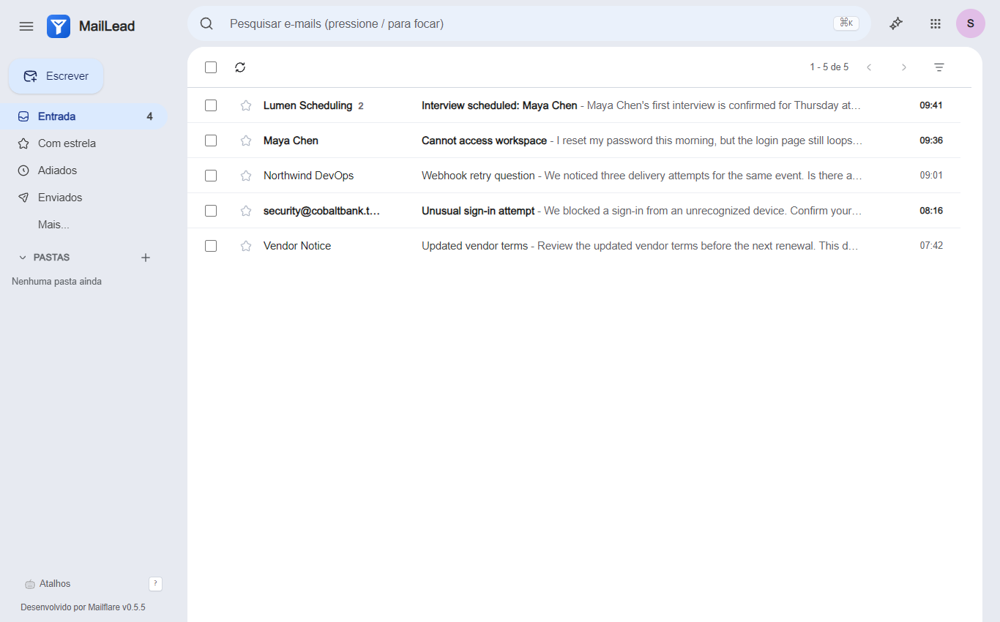<br>Caixa de entrada</td>
    <td align="center">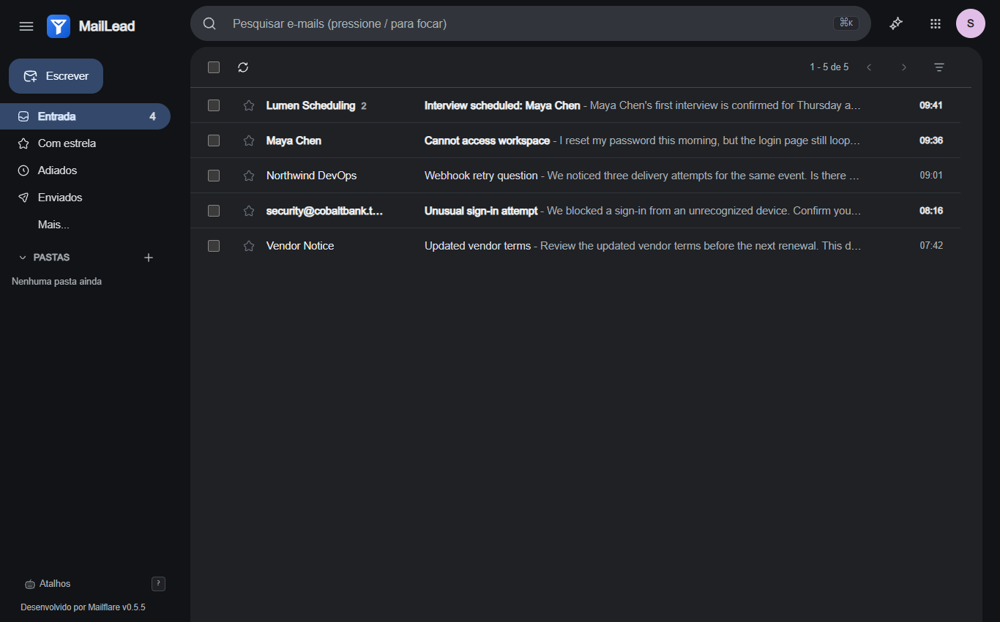<br>Tema escuro</td>
  </tr>
  <tr>
    <td align="center">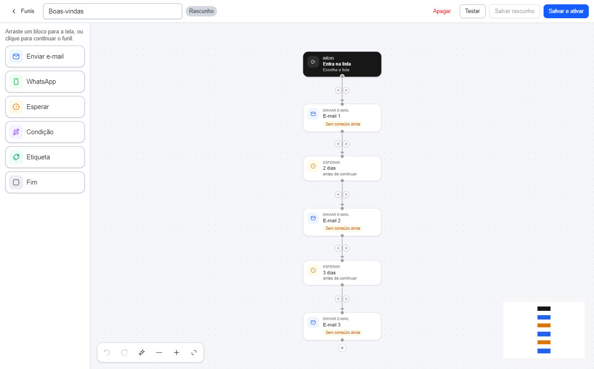<br>Editor de funil</td>
    <td align="center">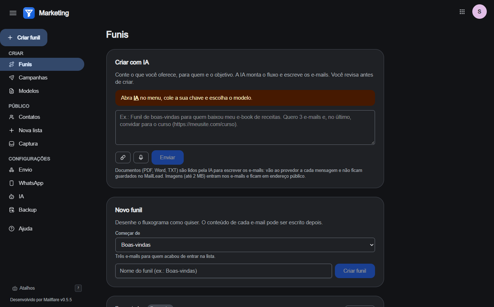<br>Funis e criação com IA</td>
  </tr>
  <tr>
    <td align="center">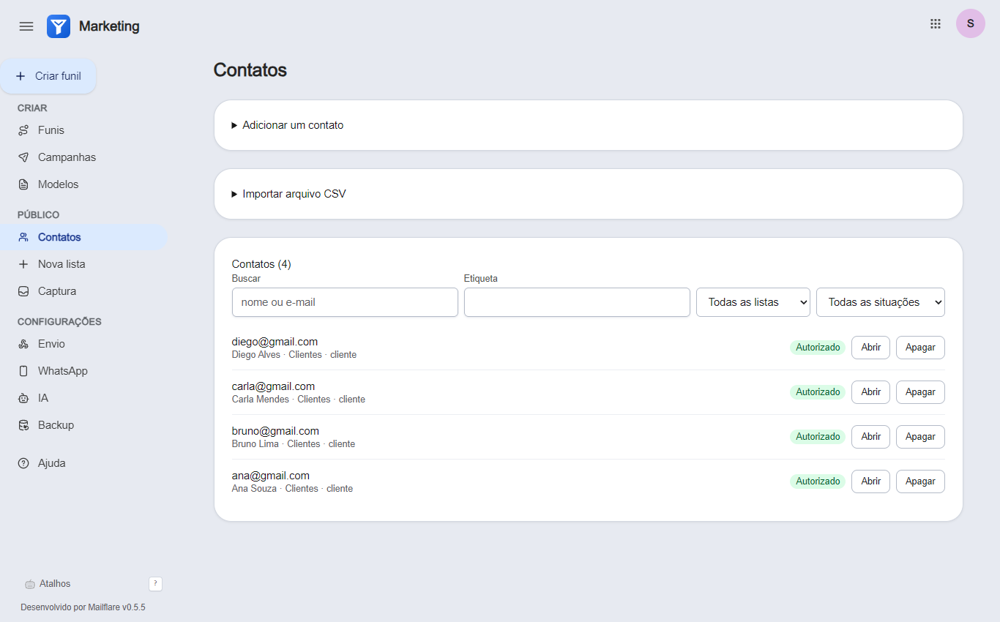<br>Contatos</td>
    <td align="center">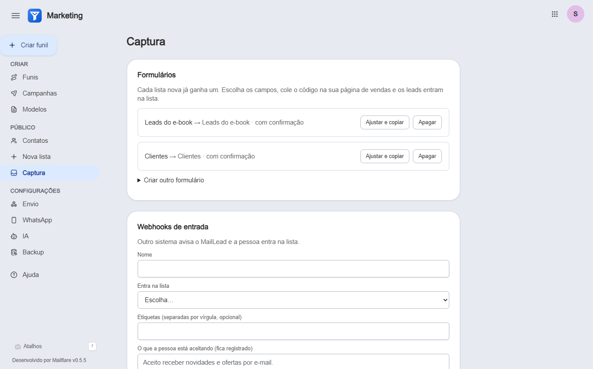<br>Captura</td>
  </tr>
  <tr>
    <td align="center">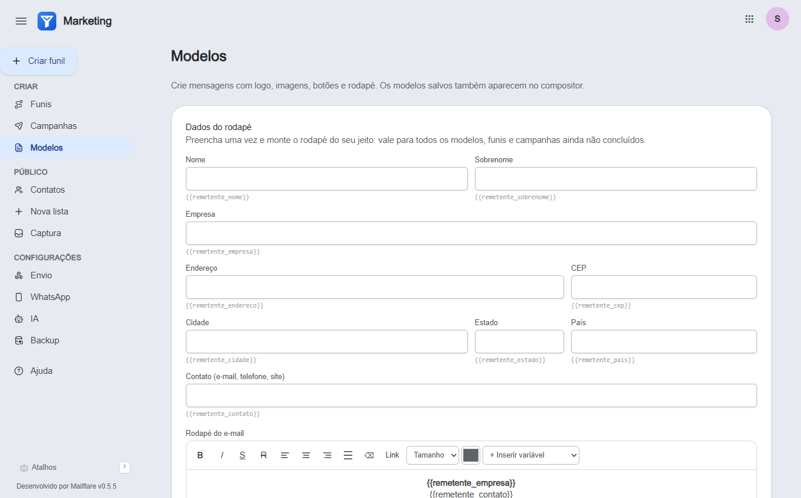<br>Modelos e rodapé</td>
    <td align="center">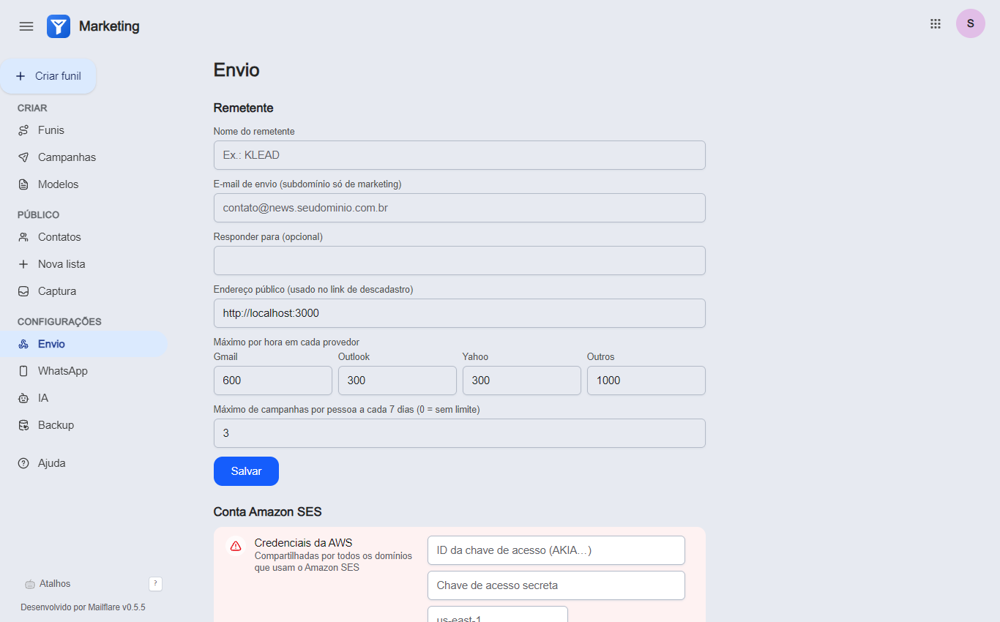<br>Envio</td>
  </tr>
  <tr>
    <td align="center">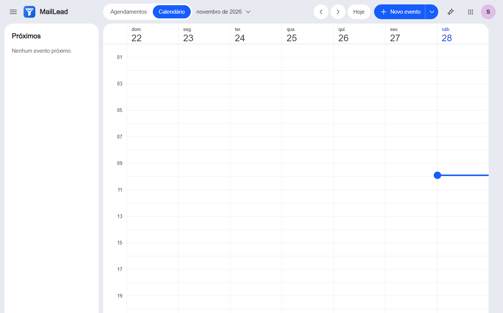<br>Calendário</td>
    <td align="center">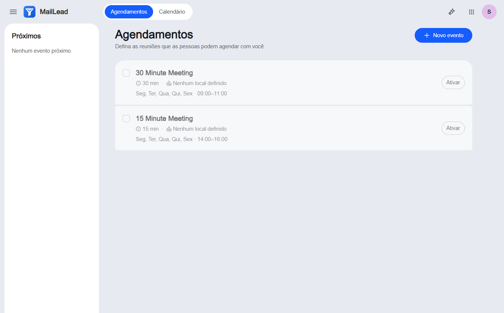<br>Agendamento</td>
  </tr>
  <tr>
    <td align="center">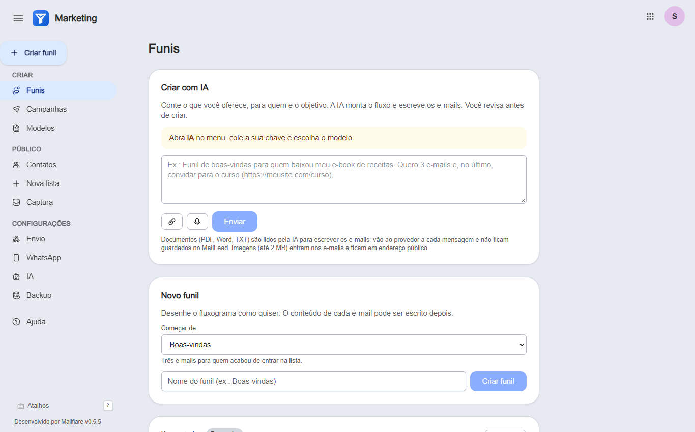<br>Marketing</td>
    <td align="center">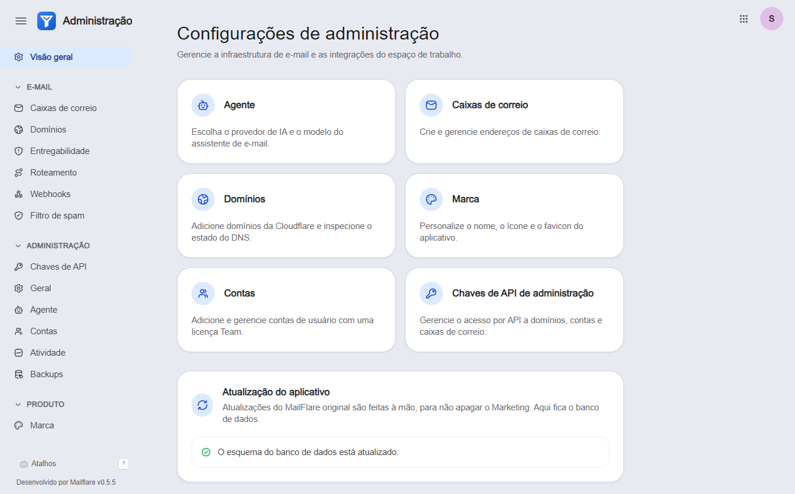<br>Administração</td>
  </tr>
</table>

As telas usam dados de demonstração.

## O que o app faz

### E-mail
- Caixas pessoais ou compartilhadas, apelidos, pastas, conversas, busca, adiar, agendar e desfazer envio.
- Regras de entrada, filtro de spam, categoria Promoções, lembretes de resposta e aviso de abertura (opcional).
- Envio e recebimento escolhidos **por domínio**: Cloudflare, Resend ou Amazon SES.
- Importação (arquivos e IMAP), contatos, assistente de IA, API, MCP e JMAP.
- Instalável no celular (PWA) com notificações push.

### Marketing
| Área | O que faz |
| --- | --- |
| **Funis** | Fluxograma com e-mail, áudio no WhatsApp, espera, condição, etiqueta e fim. Começa na entrada em uma lista ou ao receber uma etiqueta. Tem modo de teste. |
| **Modelos** | Editor por blocos, modelos prontos por uso e rodapé único. |
| **Campanhas** | Envio para inscritos, com revisão antes, aberturas, cliques e limite por pessoa. |
| **Contatos e listas** | Registro de como cada pessoa aceitou, etiquetas, importação por CSV e exclusão a pedido. |
| **Captura** | Formulários, API com chaves próprias e webhook assinado. |
| **WhatsApp** | Mensagem de voz no funil pelo seu Evolution Go, com aceite próprio, das 8h às 20h e limite diário. |
| **IA** | Desenha o funil e escreve os e-mails (OpenAI, Anthropic ou Google). A chave fica só no navegador. |
| **Backup** | Cópia diária e restauração que não desfaz descadastros. |

Só o administrador principal acessa o Marketing, que usa um banco separado.

**Confirmação por e-mail (confirmação dupla):** vem ligada nos formulários e pode ser desligada em cada um, em **Marketing → Captura**. Importação, API e webhook não pedem confirmação, porque registram o aceite que você declara: use-os para clientes que já aceitaram receber.

Guias: [funis](docs/marketing/funis.md) · [modelos](docs/marketing/modelos.md) · [captura](docs/marketing/captura.md) · [envio](docs/marketing/envio.md) · [WhatsApp](docs/marketing/whatsapp.md) · [IA](docs/marketing/ia.md) · [backup](docs/marketing/backup.md)

### Calendário e agendamento
- Visões de dia, semana e mês, eventos repetidos, lembretes por push e convites recebidos por e-mail.
- Página pública de agendamento: duração, dias e faixas de horário, vários anfitriões, horários a cada 15 minutos, antecedência mínima de 1 hora, janela de 14 dias e e-mail de confirmação com arquivo de agenda.
- **MailLead → Google Calendar:** assinatura somente leitura. Crie o link em Calendário e adicione no Google em *Adicionar agenda por URL*. O Google atualiza no ritmo dele, às vezes em horas. O link contém uma chave: trate como senha.
- **Google Calendar → MailLead:** somente importando um arquivo `.ics`. Não há sincronização automática, então compromissos feitos no Google não bloqueiam horários do agendamento.

### Drive
Arquivos e anexos com pastas, compartilhamento e lixeira.

### Administração e segurança
- Usuários, 2FA (TOTP), chaves de acesso (passkeys), chaves de API, webhooks, auditoria, backups e entregabilidade.
- HTTP é redirecionado para HTTPS, há limite de tentativas de login e os avisos do SES e da SNS têm a assinatura conferida.
- Credenciais da AWS ficam cifradas no banco quando o segredo `CONFIG_ENCRYPTION_KEY` existe.

## Estrutura na Cloudflare

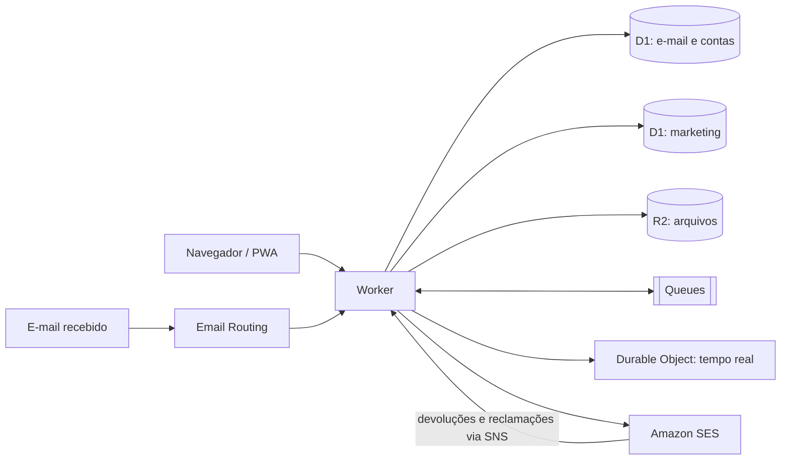

Os nomes dos recursos vêm do projeto de origem e foram mantidos para não quebrar rotas já criadas.

| Recurso | Nome | Para quê |
| --- | --- | --- |
| Worker | `mailflare` | Aplicativo, APIs, entrada de e-mail, filas e agendamentos |
| D1 (`DB`) | `mailflare` | Contas, caixas, mensagens, calendário, configurações |
| D1 (`MARKETING_DB`) | `maillead-marketing` | Contatos, listas, funis, campanhas e envios |
| R2 (`BUCKET`) | `mailflare-raw` | E-mail original, anexos, Drive, avatares e backups |
| Queues | `mailflare-inbound`, `-outbound`, `-agent` | Processamento em segundo plano |
| Durable Object | `RealtimeHub` | Atualização da tela em tempo real |
| Cron | a cada minuto, a cada 5 minutos e às 02:00 UTC | Lotes de marketing, lembretes e rotinas, backup diário |

### Armazenamento

| | Workers Free | Workers Paid |
| --- | --- | --- |
| D1, por banco | 500 MB | 10 GB (teto fixo) |
| D1, na conta | 5 GB | 5 GB inclusos, depois cobrado por GB |
| R2 | 10 GB por mês | 10 GB inclusos, depois cobrado por GB |

Quem costuma crescer primeiro é o R2 (anexos e backups). Valores podem mudar: confira [D1](https://developers.cloudflare.com/d1/platform/limits/) e [R2](https://developers.cloudflare.com/r2/pricing/).

## Domínios, subdomínios e e-mails

Exemplo com `seudominio.com.br`:

| Endereço | Uso |
| --- | --- |
| `mail.seudominio.com.br` | O aplicativo (domínio personalizado do Worker, em *Settings → Domains & Routes*) |
| `suporte@seudominio.com.br` | Caixa do dia a dia; também recebe as respostas do marketing |
| `contato@`, `info@` | Apelidos da mesma caixa |
| `send@news.seudominio.com.br` | Remetente só de marketing |
| `bounce.seudominio.com.br`, `bounce.news.seudominio.com.br` | Retorno de devoluções do SES (MAIL FROM) |

Separar o marketing em `news.` protege a reputação do e-mail do dia a dia.

### Registros DNS

| Nome | Tipo | Valor |
| --- | --- | --- |
| `seudominio.com.br` | MX e TXT (SPF) | Criados pelo Cloudflare Email Routing (recebimento) |
| `<token>._domainkey.seudominio.com.br` e `…news…` | CNAME (3 de cada) | `<token>.dkim.amazonses.com`, fornecidos pelo SES |
| `bounce.<domínio>` | MX | `10 feedback-smtp.<região>.amazonses.com` |
| `bounce.<domínio>` | TXT | `v=spf1 include:amazonses.com ~all` |
| `_dmarc.seudominio.com.br` | TXT | `v=DMARC1; p=none;` no começo, endurecendo depois |
| `_dmarc.news.seudominio.com.br` | TXT | `v=DMARC1; p=quarantine; adkim=s; aspf=r;` |

Registros do SES ficam com o proxy da Cloudflare **desligado**. Para receber relatórios DMARC, ative-os em **Admin → Deliverability** e acrescente `rua=mailto:mailflare-reports@seudominio.com.br`.

Cada domínio tem um único dono de MX: não aponte o mesmo domínio para dois serviços de recebimento.

## Amazon SES

O SES é usado de duas formas, com a mesma conta: envio do e-mail normal (quando o domínio está com o provedor *SES*) e envio do marketing.

1. Escolha uma região e peça a saída do *sandbox* (acesso de produção).
2. Verifique as identidades: o domínio e o subdomínio de marketing, com DKIM e MAIL FROM próprios.
3. Crie um usuário IAM só para o app, com o [mínimo de permissões](docs/marketing/envio.md#permissões-da-chave-da-aws). Nunca use a chave da conta raiz.
4. Cadastre a chave **na tela do app** (Marketing → Envio). Nunca em arquivo do repositório.
5. Use **Configurar eventos**: cria o *configuration set* e o tópico SNS que avisam devoluções e reclamações.
6. Para o e-mail normal, ative o retorno em **Admin → Deliverability**.

### Proteção da reputação

- Aquecimento gradual, ritmo por provedor e respeito à cota do SES.
- Disjuntor: com pelo menos 50 envios em 7 dias, pausa se devolução permanente ≥ 2% ou reclamação ≥ 0,08% (abaixo dos limites de revisão da AWS).
- Para de enviar se a AWS colocar a conta em revisão ou pausa.
- Devolução permanente e reclamação bloqueiam o endereço.
- Recusa endereços de função (`abuse@`, `postmaster@`, `noreply@` e semelhantes) e domínios sem recebimento.
- Descadastro em um clique em toda mensagem de marketing.
- Quem não abre há 180 dias fica de fora das campanhas.

Acompanhe também o painel de reputação do SES e o Google Postmaster Tools.

## Como as coisas fluem

- **Recebimento:** Email Routing → Worker → R2 guarda o original → fila → o app lê, classifica, grava no D1 e avisa a tela.
- **Envio:** compositor → fila → provedor do domínio.
- **Marketing:** formulário, API ou importação → contato com registro de aceite → funil ou campanha → lote a cada minuto → SES → eventos voltam e atualizam o contato.

## Instalar na Cloudflare

Precisa de conta Cloudflare com o domínio, Node.js e, para o marketing, conta Amazon SES.

```bash
git clone https://github.com/ricardosoli777/MailLead.git
cd MailLead
npm install
npx wrangler login
npx wrangler d1 create mailflare
npx wrangler d1 create maillead-marketing
npx wrangler r2 bucket create mailflare-raw
npx wrangler queues create mailflare-inbound
npx wrangler queues create mailflare-outbound
npx wrangler queues create mailflare-agent
```

1. Em `wrangler.jsonc`, coloque os `database_id` dos bancos que você criou. Mantenha o nome do Worker.
2. Publique e prepare o marketing:

```bash
npm run deploy
npx wrangler d1 migrations apply MARKETING_DB --remote
```

3. Cadastre os segredos com `npx wrangler secret put NOME` (o valor é pedido no terminal e não vai para o repositório):

| Segredo | Para quê |
| --- | --- |
| `CF_TOKEN` | O app configurar rotas e DNS ([permissões](docs/deployment.md)) |
| `APP_URL` | Endereço público do app |
| `CONFIG_ENCRYPTION_KEY` | Cifrar as credenciais da AWS no banco. Se perder, cadastre a chave da AWS de novo |
| `VAPID_PUBLIC_KEY`, `VAPID_PRIVATE_KEY`, `VAPID_SUBJECT` | Notificações push (opcional) |
| `TURNSTILE_SECRET_KEY` | Proteção contra robôs (opcional; use junto com `TURNSTILE_SITE_KEY`) |
| `TURNSTILE_SITE_KEY` | Chave pública do Turnstile, lida em tempo de execução |

4. Abra `/setup`, crie o administrador, ative o 2FA ou uma chave de acesso e conecte o domínio.
5. Em **Marketing → Envio**, configure o remetente no subdomínio de marketing.

## Estrutura do código

| Caminho | Conteúdo |
| --- | --- |
| `worker.ts` | Entrada do Worker: HTTP, e-mail, filas e cron |
| `src/app` | Telas e rotas de API (Next.js App Router sobre vinext) |
| `src/components` | Interface |
| `src/lib/email` | Recebimento, envio, roteamento e conversas |
| `src/lib/marketing` | Contatos, funis, campanhas, envio e captura |
| `src/lib/calendar`, `src/lib/booking` | Calendário e agendamento |
| `src/lib/aws` | Cliente SES, SNS e S3 |
| `src/db` | Esquema e acesso ao banco |
| `drizzle*`, `drizzle-marketing` | Migrações |
| `server`, `deploy` | Execução fora da Cloudflare ([guia](docs/self-hosting.md)) |
| `tests` | Testes |

## Desenvolvimento local

```bash
cp .dev.vars.example .dev.vars
npm install
npm run db:migrate:local
npx wrangler d1 migrations apply MARKETING_DB --local
npm run dev
```

Testes: `node --test tests/*.test.mjs` · Tipos: `npx tsc --noEmit`

Nunca faça commit de `.dev.vars`, chaves, senhas ou exportações com dados de contatos.

## Ainda não tem

- Sincronização de mão dupla com o Google Calendar. O CalDAV hoje só faz a descoberta da conta.
- No agendamento: link para o convidado cancelar ou reagendar, perguntas personalizadas, intervalo entre reuniões, limite por dia, link automático de videochamada, lembrete ao convidado, widget para sites e pagamento.
- Resposta "SAIR" automática no WhatsApp (hoje é o botão **Parar WhatsApp** no contato) e mensagem de texto no funil.
- Adaptadores para plataformas de venda, espera até uma data, testes A/B e pontuação de leads.

## Documentação

[Publicação](docs/deployment.md) · [Segurança](docs/security.md) · [Entregabilidade](docs/deliverability.md) · [Provedores](docs/providers.md) · [Bancos de dados](docs/databases.md) · [API](docs/api.md) · [Assistente e MCP](docs/email-assistant-and-mcp.md) · [Importação](docs/import.md) · [Solução de problemas](docs/troubleshooting.md)

## Créditos e licença

O MailLead nasceu como um fork do [MailFlare](https://github.com/hieunc229/mailflare), de `hieunc229`. Distribuído sob a [GNU AGPL-3.0](LICENSE): quem usa uma versão modificada pela rede tem direito ao código-fonte dela.

A atualização automática pelo projeto de origem fica **desligada**, porque substituiria o código inteiro. Correções de lá são trazidas à mão, com revisão dos conflitos.
